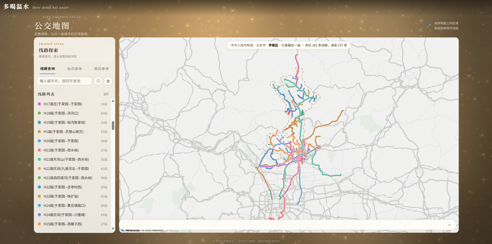

# 🚌 BabyBus 宝宝巴适 —— 公交全量线路图

> **版本：v1.1.0** · 基于 **Nuxt 4** · 高德地图 + SQLite · 全站 WebGL 氛围层

基于 Nuxt 4 的公交全量线路查询与地图可视化应用，用于可视化分析城市、地区的公交线路覆盖，辅助租房、旅游选址。

> #### 演示页：https://babybus.drinkwater.fun/busmap （演示页目前只有北京、上海、和部分山东省城市的数据）





## 🎭 视觉体系（v1.1 新增）

全站的氛围由一个零依赖的 raw WebGL 层承载，所有动效都是 shader + uniform，没有引入任何图形库。

**三层亮度，对应三段空间：**

| 空间 | 页面 | 亮度 |
|---|---|---|
| 幕后 | 登录页（门禁） | 深暖布面 + 浮尘 + 盖章 |
| 舞台 | 内容页（dashboard / buslines / districts / markdone / busmap） | 深色舞台 + 舞台灯 + 金尘 |
| 纸面 | 卡片 | 毛玻璃亮纸（表格、表单、文字都在这里） |

**InkAtmosphere（全站氛围层）**——一个组件承载所有光与尘埃：

- **布面**：竖向褶皱 fbm 缓慢流动，鼠标划过会**拨动布面**（位移场扩散回弹，褶皱跟着手扭）；
- **舞台灯**：三条光锥从页外射下、缓慢摆动，**每个页面的入射角不同**（路径 hash），切页时灯光缓缓转过去；
- **金尘**：三层视差尘埃，小圆弧游移 + 整体上浮，快呼吸 × 生命周期双层明灭——「光路里才看得见灰尘」；
- **鼠标提灯**：光标是一盏跟随的暖光，照亮的布面微亮、尘埃苏醒；
- **金尘身份**：登录后，一颗金尘在全屏**自由飞行**（弹球轨迹 + 容器/视口边界的引力弯），鼠标提灯罩住它会**减速停住**，hover 凝聚出浮签（昵称 + 退出）——身份不是角落里的文字，是舞台上那颗自由的光点；
- **时段色温**：午后偏金、深夜偏冷，按当前时间插值；
- **熄灯离场**：登出时一整页从右往左沉入黑暗，回到门禁——「离场熄灯」与「进场点灯」是同一叙事的两端。

**InkCurtain（转场幕布）**——全局跳转 Loading：路由切换时幕布瞬时全遮（撕布边、布面拉扯褶皱），接口查完自动拉开（方向按路径层级：去更深页从左拉开、返回从右）；首屏从 SSR 起就带着与幕布同色的预盖层，不会白屏闪烁。

**AppFoot（撕布边）**——页脚上方垂着一条被脚灯照亮的下缘，布缘以解析波形缓慢起伏（四层 sin 叠加、时间连续），是全站唯一「会呼吸」的静态装饰。

**其他细节**：卡片错峰入场编排、page-title 的墨字入场、hover 卡片时舞台光缓缓挪过去（只挪位置不提亮度）、毛玻璃卡片让光束从背后透成柔光斑。


## ✅ 当前已实现功能

**数据与地图**

- 高德公交线路拉取与本地 SQLite 存储（三表结构）
- 线路数据增删改查、关键词搜索、分页懒加载
- 循环拉取脚本任务（keyword 区间可配、自动跳过已入库）
- 地图多线路彩色渲染、站点空心圆点 + 站名标注
- 点击线路反查站点 → 候选线路弹窗选择
- 选中线路高亮 + 其它线路淡化
- 底部详情弹框（完整字段 + 解析后的时刻表 + 站点列表、可折叠）
- 正反向线路一键切换
- 地图页新布局（v1.1）：**左地图 + 右 tab 面板**（线路查询已上线；站点查询 / 周边查询已留口子）

**门禁与身份**

- 登录页（门禁）：账号/密码鉴权、失败整卡摇晃 + 行内错误、成功旋转盖章 + 背景光脉冲
- 已登录访问 `/login` 自动送回工作台（不盖幕）
- 顶部身份徽章（登录后显示昵称 + 登出）
- 登出 = 熄灯离场 → 盖幕 → 回门禁

**全局体验**

- 全局跳转 Loading：幕布盖住等待 → 接口查完开幕（路由守卫 + 请求自动计数，页面零改动）
- 全站氛围层（见上文「视觉体系」）

## ✅ 待实现功能

- 站点查询 / 周边查询（busmap 右侧 tab 已留口子，待接高德 POI 检索）
- 优化搜索逻辑，根据地区边界进行搜索
- 优化地图渲染逻辑，根据线路边界进行渲染

## 🧱 技术栈

| 层 | 技术 |
|---|---|
| 前端框架 | Nuxt 4（Vue 3 + Vite） |
| 状态管理 | Pinia（auth store，token / userInfo 走 cookie 持久化） |
| UI 组件 | Element Plus |
| 地图 | 高德地图 JS API 2.0（`@amap/amap-jsapi-loader`） |
| 图形 | **raw WebGL2**（零依赖 shader：氛围层 / 转场幕布） |
| 数据库 | SQLite（`better-sqlite3`，本地文件存储） |
| 服务端 | Nuxt Nitro（`server/` 目录） |

## 📁 项目结构

```
.
├── app/                          # 前端
│   ├── pages/
│   │   ├── login.vue             # 门禁（幕布后：布面 + 浮尘 + 盖章）
│   │   ├── index.vue             # 工作台（舞台：欢迎横幅 + 模块导航）
│   │   ├── buslines.vue          # 线路管理（CRUD + 循环拉取）
│   │   ├── busmap.vue            # 地图查询（左地图 + 右 tab 面板）
│   │   ├── districts.vue         # 区域数据
│   │   ├── markdone.vue          # 订单
│   │   └── lab.vue               # 动效实验台（未挂导航）
│   ├── components/
│   │   ├── InkAtmosphere.vue     # 全站氛围层：布面/舞台灯/金尘/提灯/金尘身份
│   │   ├── InkCurtain.vue        # 转场幕布（WebGL，撕布边 + 拉扯褶皱）
│   │   ├── CurtainGate.vue       # 全局 Loading 常驻壳（预盖层 + 幕布）
│   │   ├── AppHeader.vue         # 顶栏（透明，融进布面）
│   │   ├── AppFoot.vue           # 页脚 + 撕布边（解析波形缓慢起伏）
│   │   └── Map.vue               # 地图组件（多线路渲染/选中/反向切换）
│   ├── composables/
│   │   ├── useCurtainGate.ts     # 幕布门状态机（空档/兜底/hold-ready）
│   │   └── request.ts            # 统一请求封装（自动参与 Loading 计数）
│   ├── middleware/
│   │   └── curtain.global.ts     # 全局路由守卫：换页盖幕 + 已登录拦截
│   ├── stores/auth.ts            # 鉴权状态（cookie 为 source of truth）
│   ├── layouts/default.vue       # 顶栏 + main + 页脚 + 氛围层
│   └── assets/css/               # 设计令牌与分页样式（index/dashboard/...）
├── server/                       # Nitro 服务端
│   ├── api/
│   │   ├── buslines/             # 线路 CRUD + 批量地图数据接口
│   │   ├── auth/                 # 登录鉴权
│   │   └── mapApi/               # 高德地图数据拉取接口
│   └── utils/                    # sqlite / 高德封装 / 统一响应
├── data/                         # 本地 SQLite 数据库文件（运行时生成）
├── nuxt.config.ts
├── .env.example                  # 环境变量示例
└── package.json
```

## 🚀 快速开始

### 环境要求

- Node.js ≥ 20
- 高德地图开放平台 Key（Web 服务 + JS API 两个）

### 安装与运行

```bash
# 1. 安装依赖
npm install

# 2. 配置环境变量（复制并填写）
cp .env.example .env.development
#   修改 .env.development：
#   NUXT_PUBLIC_BUS_SEARCH_KEY = 你的高德 Web 服务 Key
#   NUXT_PUBLIC_MAPSC_KEY      = 你的高德 JS API Key
#   NUXT_PUBLIC_MAPSC          = 你的高德 JS API 安全密钥
#   NUXT_PUBLIC_DB_PATH        = ./data/local.db

# 3. 启动开发服务器
npm run dev
#   打开 http://localhost:3000 （未登录会落到 /login 门禁）
```

> 数据库文件会在首次启动时自动创建到 `data/local.db`（无需手动建库）。

### 生产部署（PM2）

```bash
npm run build
pm2 start .output/server/index.mjs --name babybus
# 建议加 cron_restart（每天凌晨换一次连接池）：
#   pm2 start .output/server/index.mjs --name babybus --cron-restart "0 4 * * *"
```

> 提示：PM2 的长寿进程里，undici 的 keep-alive 连接池可能攒下对端已断开的死连接（表现为偶发 `fetch failed / no response`）。建议给 server 侧 fetch 配 `keepAliveTimeout: 1000` + `retry: 1`，或用上面的定时重启兜底。

## 📄 使用说明

### 门禁（`/login`）

登录成功后盖上「放行章」→ 盖幕 → 揭开工作台。已登录再访问 `/login` 会被直接送回 `/`（不盖幕）。

### 工作台（`/`）

模块导航（公交线路 / 地区 / 订单 / 地图查询）+ 数据概览。右上角是身份徽章与登出——登出会走完整的熄灯仪式。

### 线路管理页（`/buslines`）

1. 输入城市 code 和线路关键词，点「拉取并入库」抓取线路
2. 使用「循环拉取脚本任务」按 keyword 区间批量抓取（每 1 秒一次；个人账号每天有调用上限，约一百多次）
3. 列表支持搜索、分页、编辑、删除

### 地图查询页（`/busmap`）

左侧地图 + 右侧 tab 面板（线路查询 / 站点查询 / 周边查询）。

1. 输入关键词（如「龙口」）加载线路
2. 点击地图上的线路：若附近多线经过则弹候选窗选择，选中后高亮并显示详情
3. 点击列表或地图线路均可锚中并滚动
4. 底部详情弹框可展开/收起，支持正反向线路切换
5. 面包屑在**顶部**：点击区域逐级下钻、可回上一级

## 🔌 API 接口

| 方法 | 路径 | 说明 |
|---|---|---|
| GET | `/api/buslines` | 线路列表（支持 `keyword`/`page`/`pageSize`） |
| GET | `/api/buslines/:id` | 线路详情（含有序站点） |
| GET | `/api/buslines/map` | 批量线路数据（含 polyline + 站点，用于地图） |
| POST | `/api/buslines/save` | 保存线路（已存在则跳过） |
| PUT | `/api/buslines/:id` | 更新线路 |
| DELETE | `/api/buslines/:id` | 删除线路 |
| POST | `/api/mapApi/getBusmapList` | 从高德拉取线路 |

## 🗄️ 数据表结构

- **bus_lines**：公交线路（id/name/type/polyline/citycode/start_stop/end_stop/start_time/end_time/uicolor/timedesc/distance/loop/status/direc/company/basic_price/total_price/bounds）
- **bus_stops**：公交站点（id/name/location，多线路共用去重）
- **bus_stop_sequences**：线路-站点关联（bus_id/stop_id/seq，一行一站）

## 🎨 设计令牌速查

所有光效与色板的旋钮集中在两处：

- `app/assets/css/index.css` 的 `:root`——`--stage`（舞台底色）、`--paper`（毛玻璃卡片）、`--on-stage*`（深底散字）、`--curtain*`（幕布布面）；
- `app/components/InkAtmosphere.vue` 顶部常量区——`KING_SPEED`（金尘巡游速度）、`D_CURVE / MAX_TURN`（引力弯）、`LAMP_R / HOLD_R`（提灯捕捉）、`SIM_*`（布料位移场）；
- 转场节奏在 `CurtainGate.vue`（`InkCurtain` 的 `duration`）；幕布开合状态机在 `useCurtainGate.ts`（280ms 空档 / 6s 兜底）。

## 📃 License

[MIT](./LICENSE) © xcwxa0123

